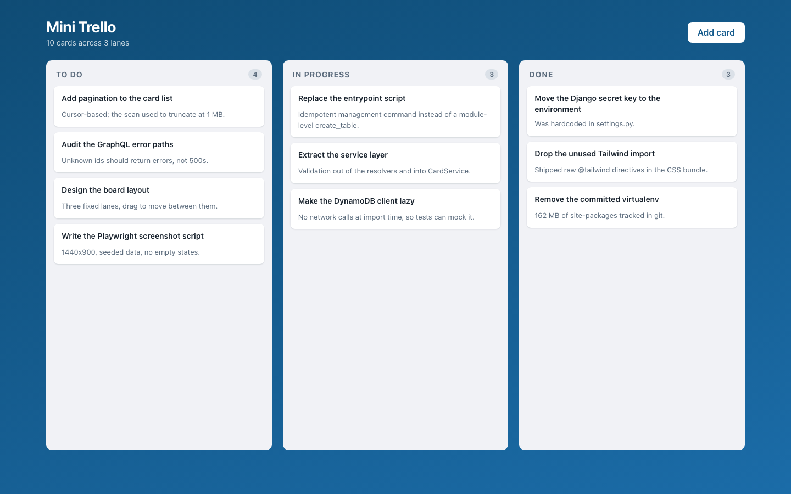

# Mini Trello

A simple kanban board with three lanes (To Do, In Progress, Done). You can add, edit and delete cards and drag them between lanes. The frontend is React with Apollo Client, the backend is a Django + Graphene GraphQL API, and cards are stored in DynamoDB.

There is one shared board and no user accounts.



**Stack:** React 18, Apollo Client, react-beautiful-dnd, Django 5.2 LTS, graphene-django 3, boto3 / DynamoDB, pytest + moto.

## Running it

### Docker Compose

```bash
docker compose up --build
docker compose exec backend python manage.py seed_board   # optional demo cards
```

The UI is on http://localhost:3000 and GraphQL on http://localhost:8001/graphql. Ports can be changed with `FRONTEND_PORT`, `BACKEND_PORT` and `DYNAMODB_PORT`.

### Manual setup

moto (a dev dependency) can act as a local DynamoDB, so no AWS account is needed.

```bash
cd mini_trello_be
python -m venv .venv && source .venv/bin/activate
pip install -r requirements-dev.txt
moto_server -p 8000 &

export DYNAMODB_ENDPOINT_URL=http://localhost:8000
export AWS_ACCESS_KEY_ID=local AWS_SECRET_ACCESS_KEY=local AWS_DEFAULT_REGION=us-west-2
python manage.py migrate
python manage.py init_dynamodb
python manage.py seed_board
python manage.py runserver 0.0.0.0:8001
```

Then in another terminal:

```bash
cd mini_trello_fe
npm ci
REACT_APP_GRAPHQL_URL=http://localhost:8001/graphql npm start
```

Backend settings are listed in `mini_trello_be/.env.example` and the frontend one in `mini_trello_fe/.env.example`. `REACT_APP_GRAPHQL_URL` is read at build time, so changing it needs a rebuild.

## Code layout

The backend app lives in `mini_trello_be/boards`:

- `lanes.py` defines the three lanes; adding a lane there makes it show up in the API and UI
- `services.py` has validation (title required, length limits)
- `repositories.py` handles DynamoDB reads and writes, including scan pagination
- `dynamodb.py` creates the boto3 client lazily from env vars
- `schema.py` contains the GraphQL types and resolvers

On the frontend, `src/hooks/useBoard.js` holds the data logic, and moves between lanes use an optimistic Apollo update.

Example requests and responses are in [docs/api-examples.md](docs/api-examples.md).

## Testing

```bash
cd mini_trello_be && pytest
ruff check . && ruff format --check .

cd mini_trello_fe && npm run test:ci
npm run lint
```

Backend tests use moto, so they don't need network access or AWS.

## Next steps

- Add authentication; right now anyone who can reach the API can read and delete every card.
- Persist card order within a lane (only moves between lanes are saved).
- Runtime requirements are locked on Django 5.2.18 / Graphene 3. The 72 backend tests use moto and need no live AWS account.
